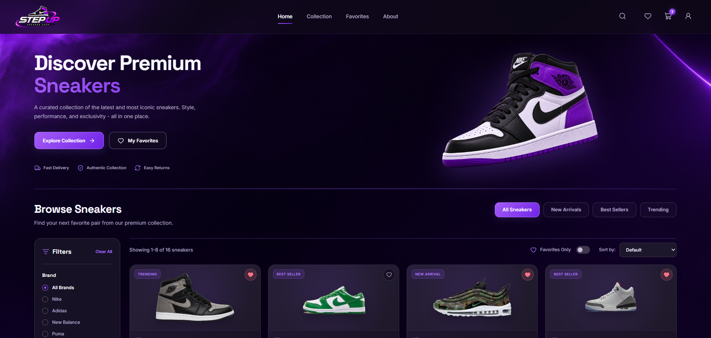

# 👟 Step Up PRO — Sneaker Shop

A modern, responsive sneaker e-commerce website built with HTML, CSS, and Vanilla JavaScript.

Step Up PRO is a frontend portfolio project featuring a dynamic sneaker collection, advanced product filtering, favorites, pagination, and a fully interactive shopping cart.

## 🌐 Live Demo

🚀 **[View Live Demo]()**

## 📸 Preview

---

## ✨ Features

- **Dynamic Sneaker Collection** — 16 sneaker products rendered dynamically using JavaScript.
- **Product Filtering** — Filter sneakers by category, brand, color, and maximum price.
- **Live Search** — Search for sneakers by product name or brand.
- **Sorting** — Sort products by price (ascending/descending) or name (A–Z).
- **Favorites System** — Add or remove favorite sneakers with localStorage persistence.
- **Shopping Cart** — Add products, remove items, adjust quantities, and calculate the total price.
- **Pagination** — Navigate between product pages with 8 sneakers per page.
- **Interactive Hero Section** — Preview selected sneakers in the main hero area.
- **Empty States** — Display informative messages when no products match the filters.
- **Responsive Design** — Optimized layouts for desktop, tablet, and mobile.
- **Modern UI** — Dark purple theme, gradients, hover effects, and Lucide icons.

## 🛠️ Technologies Used

- HTML5
- CSS3
- Vanilla JavaScript (ES6+)
- LocalStorage API
- DOM Manipulation
- Lucide Icons
- Google Fonts

No frameworks or build tools are required.

## 🧠 JavaScript Concepts

This project demonstrates practical knowledge of:

- Array methods: `filter()`, `find()`, `sort()`, `slice()`, `reduce()`, `forEach()`
- Dynamic DOM creation using `document.createElement()`
- DOM manipulation with `append()` and `replaceChildren()`
- Event listeners and event handling
- Application state management
- LocalStorage and JSON
- Conditional rendering
- Pagination calculations
- Responsive user interfaces

## 🚀 Getting Started

1. Clone or download this repository.
2. Open the project folder in Visual Studio Code.
3. Launch `index.html` using Live Server.
4. Explore the sneaker collection.

The project runs entirely in the browser and does not require a backend.

## 🛒 How It Works

The application follows a simple data-processing flow:

**DATA → STATE → FILTER → SORT → PAGINATION → RENDER**

Product data is stored in a JavaScript array.

User interactions update the application state, and the UI is dynamically rendered based on the selected filters, sorting options, and current page.

Favorites are saved using the browser's LocalStorage API.

## 📌 Project Purpose

This project was created to strengthen my frontend development skills, with a focus on Vanilla JavaScript, DOM manipulation, application state, and building interactive interfaces without frameworks.

It is part of my frontend developer portfolio.

## ⚠️ Disclaimer

This is a frontend demonstration project. It does not process real payments or orders.

The project is not affiliated with Nike, Adidas, Puma, New Balance, or any other sneaker brand.

Third-party product images, logos, and trademarks belong to their respective owners and are not covered by the project's MIT software license.

## 📄 License

The source code is licensed under the MIT License. See the [LICENSE](LICENSE) file for details.

## 👨‍💻 Author

**Samuel Jahn**

- Portfolio: https://samueljahn.sk
- GitHub: https://github.com/JohnyIsBackk

---

Built with HTML, CSS, and Vanilla JavaScript.
